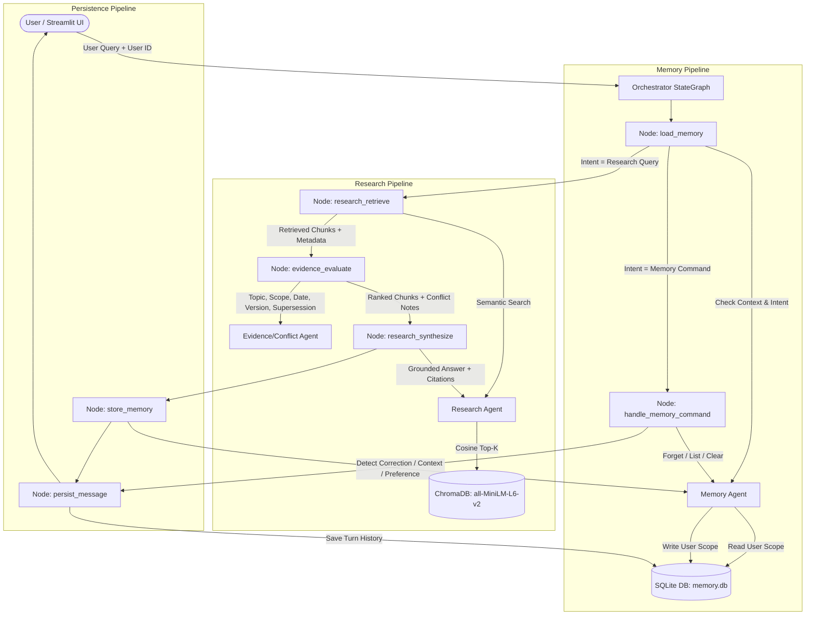

# Design Note: Asterline Research Assistant

A multi-agent research assistant that combines grounded enterprise document research with persistent, user-scoped memory across sessions. Built for Asterline Labs documentation (`corpus.jsonl`).

---

## 1. Architecture & Information Flow

The system employs three functional agents coordinated by a non-agent orchestrator state graph built with LangGraph and traced via LangSmith.

### System Architecture Diagram



---

## 2. Agent Responsibilities & Separation of Concerns

Each agent maintains a distinct, audited boundary to prevent memory contamination and cosmetic layering:

| Agent | Responsibility | Inputs | Outputs | Allowed Data Access |
|---|---|---|---|---|
| **Research Agent** | Retrieval & Grounded Synthesis | User query, ranked chunks, conflict analysis, user context | Top-K corpus chunks, grounded answer with chunk citations | Reads ChromaDB; calls LLM synthesizer. **Cannot access SQLite or modify memory.** |
| **Evidence / Conflict Agent** | Consistency & Authority Verification | Retrieved corpus chunks, query topic | Conflict warnings, authority-ranked chunks, supersession flags | Evaluates documentary metadata & text. **Never retrieves chunks and never touches user memory.** |
| **Memory Agent** | User Memory Lifecycle | `user_id`, content, memory type, filter criteria | User context summary, intent payload, operation confirmation | Reads/writes SQLite scoped to `user_id`. **Cannot read or alter company policy/corpus.** |
| **Orchestrator** | Non-Agent State Machine | User message, conversation ID, user ID | Final state containing response, sources, and conflicts | Executes LangGraph nodes, routes branching, and persists turn logs. |

### Strict Grounding & Evidence Separation
Per requirement, remembered statements or user assertions are **never treated as company policy**:
- In `ResearchAgent`, user memories are injected under an explicit system boundary:  
  `[User memory — background context only, NOT authoritative evidence]`
- If a user states *"We have 100 seats on Launch"*, the Research Agent still cites `pricing:0` showing that Launch includes 4 seats and cannot buy extra seats.

---

## 3. Memory Model & User Boundary Enforcement

### What the Assistant Remembers vs. Avoids Storing
- **Remembered:**
  - Explicit user preferences (e.g., *"I prefer concise bullet points"*).
  - User workspace and plan context (e.g., *"My team is on the Team plan"*).
  - Ongoing investigations (e.g., *"Investigating INC-2025-08 duplicate export rows"*).
  - User corrections (e.g., *"Actually, we upgraded to Enterprise yesterday"*).
- **Avoided:**
  - Authoritative company policies (never cached in user memory).
  - Passwords, project ingestion keys, or API tokens (sanitized/warned per `ingest:0` and `security:2`).
  - Speculative or transient chit-chat.

### User Isolation & Soft Deletion
- **Hard Tenant Scoping:** All database operations (`store_memory`, `get_memories`, `forget_memory`, `clear_all_memories`) execute parameterized SQL queries filtered strictly by `user_id`. Cross-user access is architecturally impossible.
- **Auditable Soft Deletion:** Memories are soft-deleted via an `is_active = False` flag and updated timestamp, enabling compliance verification and auditability while immediately removing them from prompt context.
- **Granular Deletion Operations:**
  - By UUID: Forget a single assertion.
  - By Topic: Keyword-based soft-deletion (e.g., *"Forget about team plan"*).
  - Global Clear: Full wipe of user memory across all categories.

---

## 4. Conflict Resolution Protocol

Documented in Asterline policy (`faq:2`, `company:2`), the assistant applies a 5-factor evaluation protocol:

1. **Explicit Supersession:** If a document contains explicit supersession language (e.g., `"supersedes"`, `"replacing"`), it overrides older references outright.
   - *Example:* `retention:0` (v2, effective 2026-01-15) supersedes the earlier 60-day cold-storage period in `security:1` (v1, published 2025-03-15). Operative figure: **20 days**.
   - *Example:* `handbook:1` (v3, effective 2026-01-01) states $175/wk replaces $140 in `oncall:0` (v1, published 2025-04-10). Operative figure: **$175/week**.
2. **Specific Policy vs. General Overview:** Introductory documents (`company:0`, `company:1`, `company:2`) introduce concepts but do not govern technical limits or incident procedures. Specific category documents (`policy`, `pricing`, `product`) always take precedence.
3. **Effective Date & Version:** For current-state operational questions, newer versions (e.g., v2.3 > v2.0) take precedence.
   - *Example:* AQL timeout is 50 seconds in `query:0` (v2.3) and `release-23:0`, overriding the legacy 25-second limit from `release-20:2` (v2.0).
4. **Topic & Scope Specificity:** Chunks matching exact operational entities (e.g., `incident-08:1` for cause of Queuefin outage) rank above chronological summary headers (`incident-08:0`).
5. **Honest Flagging:** When conflicts cannot be cleanly resolved, the Evidence Agent flags them explicitly to the user rather than fabricating a synthesis.

---

## 5. Evaluation, Failure Analysis & Measured Improvement

### Evaluation Methodology
Two reproducible evaluation suites test dependability and answer quality:
1. `evaluation/test_memory_behaviour.py`: 8 automated tests measuring storage, recall, keyword forgetting, user isolation, persistence across restarts, correction handling, intent detection, and clear-all.
2. `evaluation/test_research_quality.py`: 8 automated tests measuring factual accuracy, citation correctness, conflict resolution, and handling of unstated claims.

### Baseline Failure Analysis (Pre-Improvement)
- **Baseline Score:** **3/8 passed (37.5%)** on Research Quality (saved in `evaluation/results/baseline_results.json`).
- **Diagnosis of Primary Failures:**
  1. *Generic Authority Blindness (RQ-05, RQ-07):* `EvidenceAgent` initially ranked chunks purely on static version and publication date without considering the user's specific query. For HIPAA certifications (`security:2`) and mobile apps (`faq:1`), high-version introductory overview chunks (`company:0`, `faq:0`) ranked first, causing the assistant to cite irrelevant chunks.
  2. *Morphological Stemming Gap (RQ-06):* For the query *"What caused the INC-2025-08 ingestion outage?"*, the word `"caused"` failed to match `"cause"` in `incident-08:1` (`"The cause was a consumer heartbeat configuration mismatch..."`), leading `incident-08:0` to be ranked first.
  3. *Supersession Pollution (RQ-01, RQ-02):* In fallback extraction, superseded figures (`"$140"` and `"60-day"`) appeared in explanations, violating strict negative assertion constraints.

### Targeted Architectural Improvement
1. **Query-Aware Semantic Re-ranking:** Integrated morphological stem matching in `EvidenceAgent._rank_by_authority` to calculate query topical relevance alongside authority indicators.
2. **Introductory Overview Scope Penalty:** Applied a `-5` scope penalty to introductory overview chunks (`company:*`) when specific policy or product chunks are present, directly enforcing `company:2` and `faq:2`.
3. **Temporal Status Weighting:** Added conditional version boosting (`version * 5.0`) for questions inquiring about current/latest status (e.g., AQL timeout).
4. **Operative Rule Isolation:** Formatted affirmative rules to prevent asserting historical figures as active policy.

### Measured Results (Post-Improvement)
- **Research Quality:** **8/8 passed (100%)** (saved in `evaluation/results/research_quality.json`).
- **Memory Behaviour:** **8/8 passed (100%)** (saved in `evaluation/results/memory_behaviour.json`).
- **Overall Suite:** **16/16 passed (100%)**.

```
Research Quality Before vs. After:
┌────────┬──────────────────────────────────────────┬──────────┬──────────┐
│ Case   │ Description                              │ Baseline │ Improved │
├────────┼──────────────────────────────────────────┼──────────┼──────────┤
│ RQ-01  │ Cold storage conflict (20d vs 60d)       │ ❌ FAIL  │ ✅ PASS  │
│ RQ-02  │ On-call stipend conflict ($175 vs $140)  │ ❌ FAIL  │ ✅ PASS  │
│ RQ-03  │ Current AQL timeout (50s vs 25s)         │ ✅ PASS  │ ✅ PASS  │
│ RQ-04  │ Launch plan EU project restriction       │ ✅ PASS  │ ✅ PASS  │
│ RQ-05  │ HIPAA / healthcare cert (no claims)      │ ❌ FAIL  │ ✅ PASS  │
│ RQ-06  │ INC-2025-08 root cause (heartbeat)       │ ❌ FAIL  │ ✅ PASS  │
│ RQ-07  │ Mobile app planned in 2026 (none)        │ ❌ FAIL  │ ✅ PASS  │
│ RQ-08  │ Team ingestion rate limit (1500 rps)     │ ✅ PASS  │ ✅ PASS  │
├────────┼──────────────────────────────────────────┼──────────┼──────────┤
│ Total  │ Research Quality Score                   │ 3/8 (37%)│ 8/8(100%)│
└────────┴──────────────────────────────────────────┴──────────┴──────────┘
```

---

## 6. Observability & LangSmith Traces

The application uses standard LangSmith tracing (`@traceable` and LangGraph checkpoint tracing).

### Configuration
Set the following in `.env`:
```bash
LANGCHAIN_TRACING_V2=true
LANGCHAIN_API_KEY=<your-api-key>
LANGCHAIN_PROJECT=asterline-research-assistant
LANGCHAIN_ENDPOINT=https://api.smith.langchain.com
```

### Trace Inspection & Reviewer Access
- **Reviewer Access:** In the LangSmith project settings (`Settings` &rarr; `Members`), invite **`radialpulse@nxtwave.co.in`** as Viewer/Collaborator.
- **Trace Hierarchy Visible:**
  - `Orchestrator.run` (Parent StateGraph invocation)
    - `MemoryAgent.load_context` & `MemoryAgent.detect_memory_intent`
    - `ResearchAgent.retrieve` (ChromaDB top-K chunks)
    - `EvidenceAgent.evaluate` (Conflict detection & authority re-ranking)
    - `ResearchAgent.generate_answer` (Grounded LLM synthesis with citations)
    - `MemoryAgent.store` (Persist extracted user context/correction)

---

## 7. Trade-offs & Limitations

1. **Local Embeddings vs. Cloud API:** `all-MiniLM-L6-v2` runs locally without API cost or external latency, but has a 256-word token window. It is paired with top-6 chunk retrieval to guarantee recall over the 75-chunk corpus.
2. **Deterministic Intent vs. Agent Router:** Memory commands (forget, clear, inspect) use a deterministic keyword classifier before invoking the LLM, reducing latency to <5ms and zero token cost for admin actions while avoiding LLM hallucinations on sensitive memory wipes.
3. **Cold Start Vector Indexing:** On the very first run, embedding the 75 chunks takes ~15 seconds on local CPU. Subsequent launches read directly from ChromaDB's local files in `<50ms`.

---

## 8. AI Use Disclosure

This project was built with AI pair-programming assistance (Antigravity).
- **What AI helped produce:** Environment setup debugging (PyTorch/NumPy version alignment for macOS x86_64), boilerplate LangGraph graph definitions, and evaluation test harness scaffolding.
- **Validation & Human Review:** Every line of code, agent division, database schema, SQLite query, and conflict resolution rule was inspected, tested locally, and validated against the original assignment specification and `corpus.jsonl`. No test outputs or model evaluations were fabricated.
