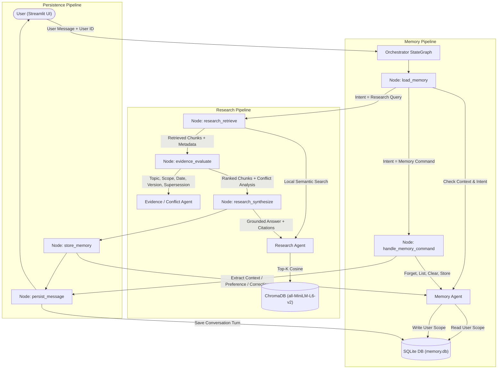

# Asterline Research Assistant (`multi-agent-assistant`)

A multi-agent AI assistant that helps Asterline Labs employees find trustworthy answers in company documentation and continues useful work across conversations.

Repository: [https://github.com/VitCritical/multi-agent-assistant](https://github.com/VitCritical/multi-agent-assistant)

---

## Quick Start (One Command)

```bash
# 1. Clone and enter the project
git clone https://github.com/VitCritical/multi-agent-assistant.git
cd multi-agent-assistant

# 2. Create and activate virtual environment
python3 -m venv .venv
source .venv/bin/activate

# 3. Install dependencies
pip install -r requirements.txt

# 4. Set up environment
cp .env.example .env
# Edit .env and fill in GOOGLE_API_KEY and LANGCHAIN_API_KEY

# 5. Launch the application
streamlit run app.py
```

The app will open at http://localhost:8501.  
On first run, it embeds the corpus into ChromaDB (takes ~30 seconds). Subsequent starts are instant.

---

## Environment Variables

| Variable | Description |
|---|---|
| `GOOGLE_API_KEY` | Google AI Studio API key (for Gemini 1.5 Flash) |
| `GEMINI_MODEL` | Default: `gemini-1.5-flash` |
| `LANGCHAIN_TRACING_V2` | Set to `true` to enable LangSmith tracing |
| `LANGCHAIN_API_KEY` | Your LangSmith API key |
| `LANGCHAIN_PROJECT` | LangSmith project name |

Get a free Google API key at: https://aistudio.google.com  
Get a free LangSmith key at: https://smith.langchain.com

---

## Project Structure

```
.
├── app.py                        # Streamlit UI — one command launch
├── corpus.jsonl                  # Knowledge base (75 chunks, UNCHANGED)
├── requirements.txt              # Pinned compatible dependencies
├── .env.example                  # Template with non-secret configurations
├── DESIGN_NOTE.md                # Architectural design note & trade-offs
├── src/
│   ├── config.py                 # Centralised config + env loading
│   ├── corpus_loader.py          # Embed corpus → ChromaDB (local)
│   ├── database.py               # SQLite setup, session factory
│   ├── models.py                 # SQLAlchemy ORM models
│   ├── agents/
│   │   ├── orchestrator.py       # LangGraph StateGraph — coordination
│   │   ├── research_agent.py     # Local retrieval + grounded answer generation
│   │   ├── evidence_agent.py     # Evidence evaluation, authority re-ranking & conflict detection
│   │   └── memory_agent.py       # Per-user memory CRUD & isolation
│   └── tools/
│       ├── memory_tools.py       # DB-level memory operations
│       └── conflict_tool.py      # Known supersessions & conflict logic
├── evaluation/
│   ├── test_research_quality.py  # 8 research quality test cases
│   ├── test_memory_behaviour.py  # 8 memory behaviour test cases
│   └── results/                  # JSON evaluation results (baseline + final)
└── data/                         # Created at runtime
    ├── chroma/                   # ChromaDB persistent vector store
    └── memory.db                 # SQLite per-user memory store
```

---

## Running Evaluations

```bash
# Research quality (requires GOOGLE_API_KEY)
python -m evaluation.test_research_quality

# Memory behaviour (no LLM needed)
python -m evaluation.test_memory_behaviour
```

Results saved to `evaluation/results/`.

---

## Architecture



Three genuine functional agents coordinated by a non-agent LangGraph orchestrator:

### 1. Research Agent
Semantic search over ChromaDB (`all-MiniLM-L6-v2` local embeddings), returning documentary evidence with source metadata, and grounded answer synthesis citing exact chunk IDs. Never accesses or modifies user memory.

### 2. Evidence / Conflict Agent
Evaluates retrieved chunks for contradictions, scope (`company:2`), effective dates, versions (e.g. v2.3 > v2.0), and explicit supersession statements (`faq:2`). Re-ranks chunks by authority and query relevance, flagging unresolved conflicts. Never performs retrieval or accesses user memory.

### 3. Memory Agent
Manages all per-user memory lifecycle operations: store, load context, detect intent, soft-delete by keyword/id, and clear all. Strictly scoped to `user_id` in SQLite — cross-user access is impossible.

### 4. Orchestrator (LangGraph StateGraph)
Coordinates the workflow state:  
`load_memory` &rarr; `route` &rarr; `[research_retrieve → evidence_evaluate → research_synthesize | handle_memory_command]` &rarr; `store_memory` &rarr; `persist_message`.

---

## LangSmith Observability

To inspect executions and agent spans:
1. Provide `LANGCHAIN_TRACING_V2=true` and `LANGCHAIN_API_KEY` in `.env`.
2. Reviewers can be granted access by inviting **`radialpulse@nxtwave.co.in`** to your project in the LangSmith dashboard.
3. Every agent step (`MemoryAgent.load_context`, `ResearchAgent.retrieve`, `EvidenceAgent.evaluate`, `ResearchAgent.generate_answer`, `MemoryAgent.store`) produces inspectable nested spans.

---

## Cost & Account Requirements

| Service | Cost | Requirement |
|---|---|---|
| Gemini 1.5 Flash | Free tier available (60 req/min) | Google account + AI Studio |
| LangSmith | Free tier (up to 5k traces/month) | Account at smith.langchain.com |
| Embeddings | Free — local `sentence-transformers` | None |
| ChromaDB | Free — local file | None |
| SQLite | Free — local file | None |

---

## AI Use Disclosure

This project was built with AI assistance from two tools:
- **ChatGPT (OpenAI):** Used for initial architectural planning and discussion, leading to the decision to transition from treating the orchestrator as an agent to an architecture of three separate, genuine functional agents (Research, Evidence/Conflict, and Memory) coordinated by a non-agent LangGraph orchestrator.
- **Antigravity (Google DeepMind / Gemini / Claude):** Used for local environment debugging, SQLAlchemy schema implementation, LangGraph node wiring, ChromaDB integration, and evaluation test harness scaffolding.
- **Human Review & Validation:** All code, database models, conflict resolution rules, and evaluation results were reviewed, debugged, and validated against the original assignment specification and `corpus.jsonl`. No test outputs or model evaluations were fabricated.
